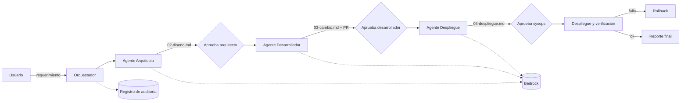
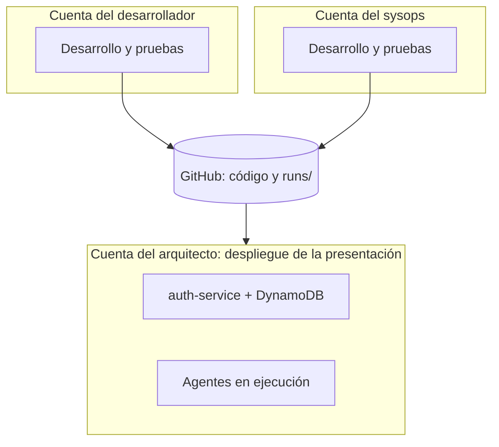

# Arquitectura

> Propuesta inicial, sujeta a cambios del equipo.

## Vista general

## Cuentas AWS

Los recursos de AWS no se comparten entre cuentas. Los artefactos entre agentes viajan por Git.

## Componentes
| Componente | Tecnología | Responsable |
|---|---|---|
| Orquestador | Strands Agents (grafo o flujo secuencial) con puntos de aprobación | Arquitecto |
| Agente Arquitecto | Strands Agents + Bedrock, base de estándares en Markdown | Arquitecto |
| Agente Desarrollador | Strands Agents + Bedrock, herramientas de archivos, Git y pruebas | Desarrollador |
| Agente Despliegue | Strands Agents + Bedrock, herramientas de CDK y CloudWatch | Sysops |
| Servicio demo `auth-service` | Lambda + API Gateway + DynamoDB | Desarrollador (código), Sysops (infraestructura) |
| Auditoría | Archivo JSONL por ejecución en `runs/<id>/audit.jsonl` | Arquitecto |

## Decisiones iniciales
1. **Artefactos en archivos Markdown versionados** y no en una base de datos. Es más simple, funciona entre cuentas y la auditoría queda gratis en Git.
2. **Aprobación humana como paso bloqueante** en el orquestador. Sin aprobación `aprobado` en el artefacto anterior, el siguiente agente no corre.
3. **Los agentes pueden ejecutarse localmente** durante el desarrollo, en cada cuenta, y solo el despliegue final va a la cuenta del arquitecto.
4. **Modelo por defecto:** `us.anthropic.claude-sonnet-4-6`, y Haiku 4.5 para pasos simples.
