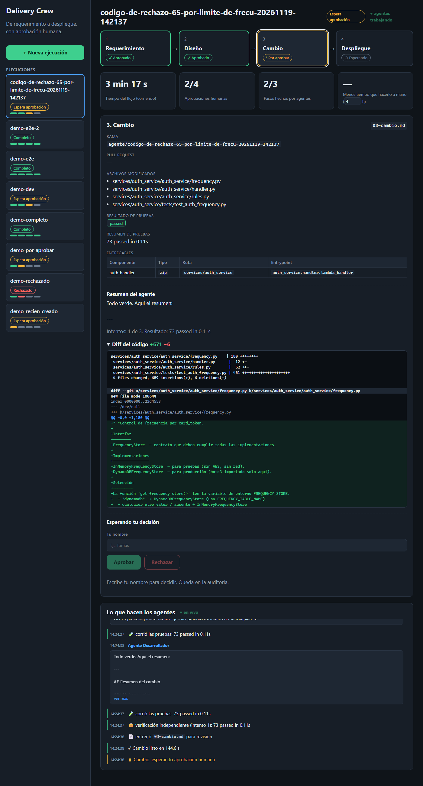

# Demo en vivo



Todo corre en la laptop de quien presenta. Lo único que usa AWS es Bedrock (el modelo de los agentes).

## Antes de presentar

1. **Credenciales nuevas.** Las del workshop vencen en algunas horas: sacarlas de Workshop Studio y cargarlas en la terminal 1.
2. **Comprobar Bedrock:**
   ```powershell
   .\.venv\Scripts\python.exe -m delivery_crew.check_env
   ```
3. **Plan B:** dejar en el panel una ejecución completa ya hecha (por ejemplo, una corrida de ensayo). Si falla la red o Bedrock, se muestra esa.

## Levantar

**Terminal 1: API y agentes** (con las credenciales AWS cargadas en esta terminal)
```powershell
cd agentic-ambassadors-project
.\.venv\Scripts\python.exe -m delivery_crew.api
```
Al arrancar muestra la cuenta que usará para el plan de despliegue (por defecto, la de las credenciales).

**Terminal 2: panel**
```powershell
cd agentic-ambassadors-project\panel
npm run dev
```
Abrir http://localhost:5173.

## Guion (unos 5 minutos)

1. **+ Nueva ejecución.** El caso del código 65 viene precargado. Escribir tu nombre y presionar **Lanzar agentes**.
2. **Arquitecto (~30 s).** En "Lo que hacen los agentes" se ve cómo evalúa el requerimiento contra los estándares ARQ-01 a ARQ-07. Al terminar, la etapa Diseño queda **por aprobar**: mostrar el veredicto, los componentes y la configuración, y **Aprobar**.
3. **Desarrollador (~2-3 min).** Se ve en vivo qué archivos lee y escribe, cada corrida de pruebas y la verificación independiente. Si una prueba falla, se ve cómo corrige. Al terminar: mostrar el **diff** y los entregables.
   - Para mostrar la compuerta humana: **Rechazar** con un motivo (por ejemplo, "agregá una prueba con 2 solicitudes por minuto durante 5 minutos") y presionar **Que el agente lo rehaga con el motivo**. El agente vuelve a empezar con ese motivo.
4. **Despliegue (~1 s).** Mostrar el plan: recursos, parámetros tomados del diseño, rollback. **Aprobar.**
5. **Cierre.** Tiempo total del flujo contra el estimado manual (editable en horas), aprobaciones humanas y la auditoría completa.

## Si algo falla

| Síntoma | Qué hacer |
|---|---|
| El panel dice que no puede conectar con la API | La terminal 1 no está corriendo |
| La etapa queda en "falló" con `ExpiredToken` o `UnrecognizedClient` | Credenciales vencidas: renovarlas, reiniciar la terminal 1 y presionar **Reanudar agentes** |
| Se reinició la API a mitad de una ejecución | Presionar **Reanudar agentes**: sigue donde quedó |
| El agente tarda demasiado | Mostrar la ejecución del plan B |

## Qué no hace

- La etapa 4 genera el plan y el bundle de despliegue, pero no ejecuta el despliegue en AWS.
- El código que escribe el agente queda en una rama local `agente/<id>`; no se sube a GitHub salvo que se haga a mano.
