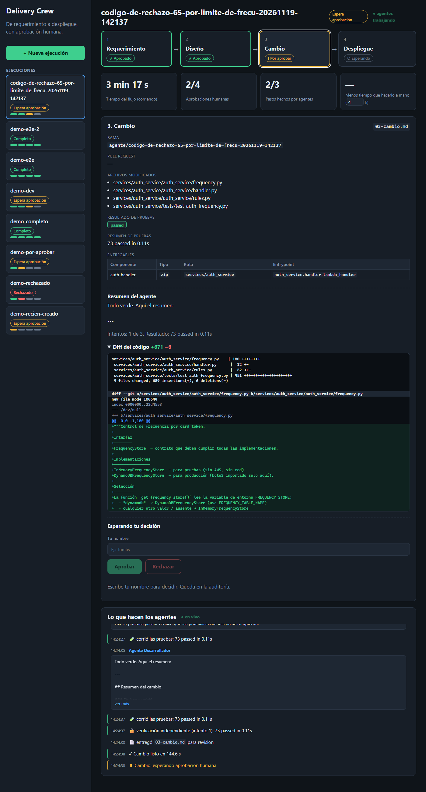

# Panel de control (React + Vite)



Para la demo completa (lanzar agentes desde el panel), ver `docs/demo-en-vivo.md`.

## Levantarlo

Se necesitan dos terminales, las dos desde la raíz del repositorio.

**Terminal 1: API**
```powershell
.\.venv\Scripts\python.exe -m delivery_crew.api.samples runs    # solo la primera vez: datos de ejemplo
.\.venv\Scripts\python.exe -m delivery_crew.api --port 8000
```

**Terminal 2: front**
```powershell
cd panel
npm install        # solo la primera vez
npm run dev
```

Abrir http://localhost:5173 (si el puerto está ocupado, Vite usa otro y lo indica en la terminal).

Vite reenvía `/api/...` a `http://127.0.0.1:8000`. Para otra dirección: `$env:API_URL="http://127.0.0.1:9000"; npm run dev`.

## Qué muestra

- Lista de ejecuciones con su estado y una barra de cuatro etapas.
- Pipeline Requerimiento → Diseño → Cambio → Despliegue, con colores por estado. Se puede hacer clic en cada etapa.
- Detalle del artefacto de la etapa elegida.
- Botones Aprobar y Rechazar cuando la etapa está `por_aprobar`. El nombre de quien decide se guarda en el navegador y queda en la auditoría. El rechazo pide motivo.
- Métricas: tiempo del flujo, aprobaciones, pasos hechos por agentes y ahorro frente a un tiempo manual editable (en horas).
- Auditoría, de lo más reciente a lo más antiguo.

Se refresca cada 2 segundos, así que los cambios que escriban los agentes en `runs/` aparecen solos.

## Estructura

| Archivo | Contenido |
|---|---|
| `src/types.ts` | Tipos del contrato de la API (ver `docs/api.md`) |
| `src/api.ts` | Llamadas a la API |
| `src/artifact.tsx` | Qué campos mostrar de cada tipo de artefacto |
| `src/App.tsx` | Pantalla completa |
| `src/styles.css` | Estilos (tema oscuro, pensado para proyectar) |

Para volver a los datos de ejemplo originales: borrar la carpeta `runs/` y repetir el comando de `samples`.
